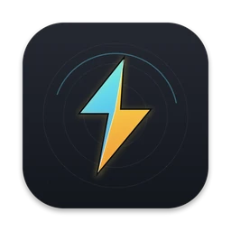
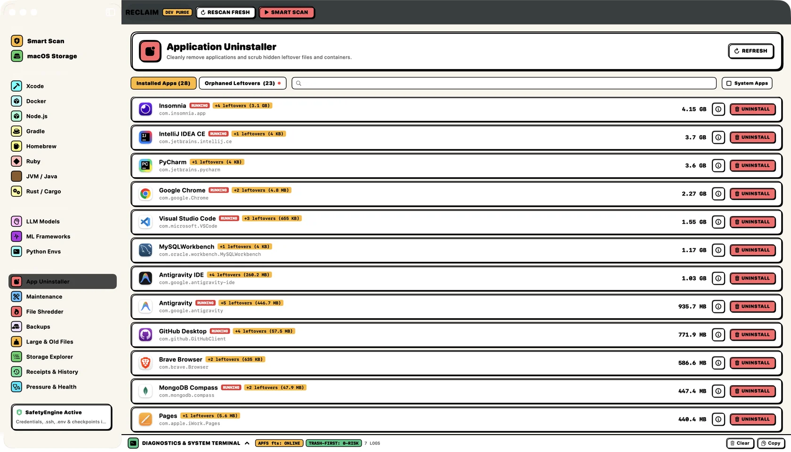
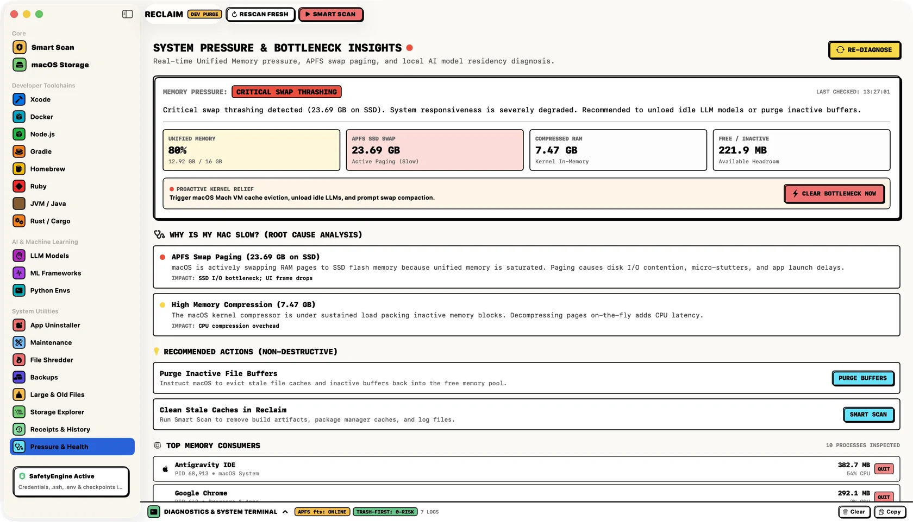

<div align="center">



# ⚡ Reclaim

### Developer-First Storage Intelligence & System Pressure Optimizer for macOS

[](https://swift.org)
[](https://www.apple.com/macos)
[](Tests/)
[]()
[](LICENSE)

*Taking back lost gigabytes, relieving memory pressure, and reclaiming macOS compute speed.*

</div>

---

## 🎯 What is Reclaim?

Traditional Mac cleaners are built for casual consumers—opaque "black boxes" that treat gigabytes of data generically and risk breaking developer environments.

**Reclaim** is an open-source, developer-first macOS optimizer engineered specifically for modern software engineers, ML practitioners, and power users. Built in native Swift 6 and SwiftUI with a distinctive **Neo-Brutalist Pop / Retro Tech** interface, it specializes in diagnosing and reclaiming deep developer disk bloat and Mach VM system memory bottlenecks.

---

## 📸 Screenshots

<div align="center">

### 1. Application Uninstaller with Original Native Icons
*Sub-second parallel discovery, real Retina app icons, and hidden Library leftover scrubbing.*



<br/><br/>

### 2. System Pressure & Bottleneck Sentinel
*Real-time Darwin Mach VM telemetry, APFS swap thrashing diagnostics, and 1-click kernel memory relief.*



</div>

---

## ✨ Key Features

### 🔍 1. Developer Toolchains & AI Storage Discovery
Deep recursive inspection tailored to modern programming stacks:
- **Local AI & ML Runtimes:** Ollama model weights, Hugging Face hub, PyTorch, Triton, ONNX, and GGUF checkpoint caches.
- **Developer Ecosystems:** Docker build caches and dangling images, Xcode `DerivedData` and DeviceSupport, `node_modules` workspaces, Rust `target/` directories, Gradle caches, Python virtual environments (`.venv`, conda, pip), and JVM caches.
- **Large & Old Installers:** Discovers buried `.dmg`, `.pkg`, `.iso`, and archive files.

### ⚡ 2. Blazing-Fast App Uninstaller & Leftover Cleaner
- **Multi-Core Parallel Analysis:** Analyzes installed apps concurrently across CPU cores (`DispatchQueue.concurrentPerform`), dropping discovery time to **under 0.5s**.
- **Original macOS Icons:** Dynamically renders the authentic, high-res `.icns` of every application using `NSWorkspace.shared.icon(forFile:)`.
- **Orphan Leftover Mapping:** Identifies hidden data left behind by uninstalled apps across `~/Library/Application Support`, `~/Library/Caches`, `Containers`, and `Preferences`.

### 🧠 3. Live System Slowness Diagnostics & 1-Click Remedy
Solves the common Apple Silicon issue where M1/M2/M3 Macs slow down after 1–2 hours of heavy LLM and multi-IDE usage:
- **Direct Mach VM Kernel Telemetry:** Reads live unified memory ratios, kernel in-memory compression, and APFS SSD swap paging using `host_statistics64` and `sysctlbyname("vm.swapusage")`.
- **0% CPU Kernel Sentinel:** Uses Darwin `DispatchSource.makeMemoryPressureSource` to sleep at 0% CPU, waking only when the macOS memory manager fires pressure events.
- **1-Click Kernel Relief:** Triggers Mach VM inactive file buffer purge, unloads idle Ollama models from unified VRAM (`keep_alive: 0`), and prompts the macOS `dynamic_pager` to compact SSD swap.
- **Top Process Ranking:** Inspects top resident memory consumers with 1-click `[QUIT]` controls for runaway workers.

### 🛡️ 4. Zero-Risk Trash-First Safety Engine & Terminal Drawer
- **Trash-First Guarantee:** Non-destructive by design—items are moved to the macOS Trash so they can always be restored if needed.
- **Protected System Paths:** System directories (`/System`, `/usr/bin`), developer credentials (`.ssh`, `.aws`, `.kube`, `.gnupg`), and active project files are strictly whitelisted and immune to automatic cleanup.
- **Transparent Terminal Drawer:** A live embedded console prints every single scanned path, byte calculation, and action in plain text for total transparency.

---

## 🚀 Quick Start (Build & Compile from Source)

Anyone with a Mac running macOS 13.0+ can build and run Reclaim in seconds with **zero external dependencies**.

### Prerequisites
* **macOS 13.0 (Ventura)** or later (Apple Silicon or Intel)
* **Swift 6.0+** (included with Xcode or Command Line Tools: `xcode-select --install`)

### 1. Clone the Repository
```bash
git clone https://github.com/hameersingh70/reclaim.git
cd reclaim
```

### 2. Run the Test Suite (163 Tests)
Verify the entire scanning, safety, diagnostic, and analyzer pipeline:
```bash
make test
# or: swift run ReclaimTests
```

### 3. Build & Package the Desktop Application (`Reclaim.app`)
Run the automated build script. It compiles the release binary, generates the Retina `.icns` iconset, applies macOS privacy entitlements, and code-signs the bundle:
```bash
make app
# or: ./scripts/bundle_app.sh
```

### 4. Launch Reclaim
```bash
make run
# or: open Reclaim.app
```

---

## 🛠️ Build Commands (Makefile)

| Command | Action |
| :--- | :--- |
| `make build` | Compiles the release binary via Swift Package Manager |
| `make test` | Executes the full 163-test verification suite |
| `make app` | Assembles and code-signs `Reclaim.app` desktop bundle |
| `make run` | Builds and launches `Reclaim.app` on your desktop |
| `make icon` | Regenerates `AppIcon.icns` across all 10 Retina resolutions |
| `make clean` | Cleans build artifacts and packaged bundles |

---

## 🏛️ Architecture Overview

The codebase is organized into a clean decoupled architecture:

```
Reclaim/
├── Package.swift               # SwiftPM Manifest
├── Makefile                    # Developer build shortcuts
├── scripts/
│   ├── bundle_app.sh           # Assembles, packages, and code-signs Reclaim.app
│   └── generate_app_icon.swift # CoreGraphics script generating 10-resolution AppIcon.icns
├── Sources/
│   ├── Reclaim/                # Core Business Logic & Diagnostic Engine
│   │   ├── Core/
│   │   │   ├── Domain/         # StorageItem, StorageRiskLevel, AnalysisContext
│   │   │   ├── Scanner/        # FileScanner, AppUninstallerScanner, SystemStorageInspector
│   │   │   ├── Analyzers/      # Docker, Xcode, Node, Ollama, Python, Gradle, Rust
│   │   │   ├── Safety/         # SafetyEngine (credential & system protection)
│   │   │   ├── Diagnostics/    # SystemPressureDiagnostics, LightweightSentinelMonitor
│   │   │   └── Maintenance/    # SystemMaintenanceEngine (purge, DNS, snapshots)
│   │   └── AppState.swift      # Central observable state machine
│   └── ReclaimUI/              # Native macOS SwiftUI Presentation Layer
│       ├── DesignSystem/       # Neo-Brutalist design tokens (HackerTheme, ThemeManager)
│       ├── Views/              # Modular screens (SmartScan, AppUninstaller, Pressure, etc.)
│       └── main.swift          # App entrypoint, NSStatusBar item & window lifecycle
└── Tests/
    └── ReclaimTests/           # Unit & end-to-end integration tests (163 tests)
```

---

## 🤝 Contributing

Contributions, issues, and feature requests are welcome!
1. Fork the Project
2. Create your Feature Branch (`git checkout -b feature/AmazingFeature`)
3. Commit your Changes (`git commit -m 'Add some AmazingFeature'`)
4. Verify Tests Pass (`make test`)
5. Push to the Branch (`git push origin feature/AmazingFeature`)
6. Open a Pull Request

---

## 📄 License

Distributed under the **MIT License**. See [`LICENSE`](LICENSE) for more information.

---

<div align="center">
Crafted with ⚡ for the macOS Developer Community.
</div>
